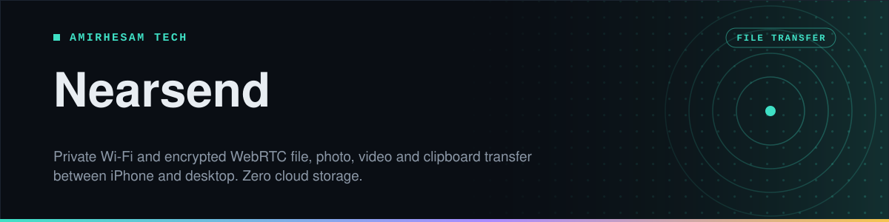
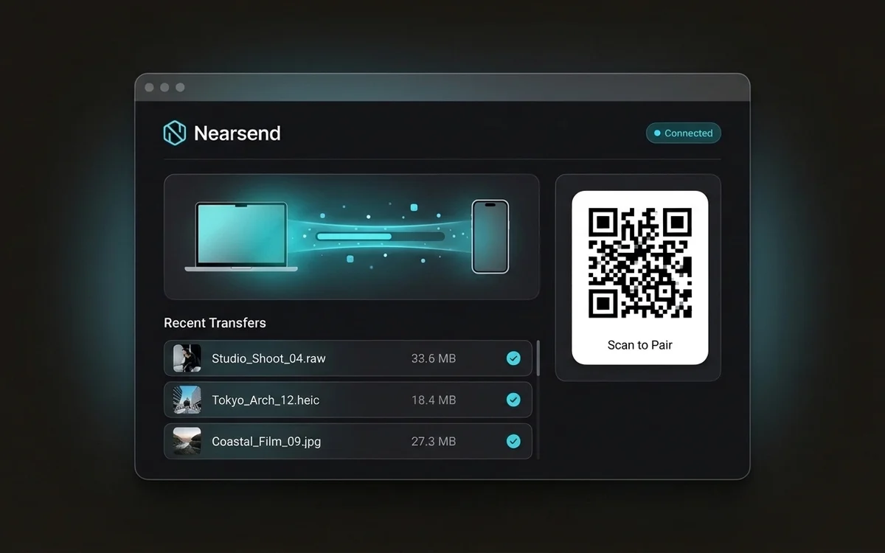

<p align="center">
  
</p>

<p align="center">
  <a href="https://nearsend-dun.vercel.app"></a>
  
  
  
  
  
  <a href="https://github.com/amirh3sam/nearsend/stargazers"></a>
</p>

<p align="center">
  <a href="https://nearsend-dun.vercel.app"><b>Open the app</b></a> ·
  <a href="#what-it-does">What it does</a> ·
  <a href="#two-ways-to-use-it">Two ways to run</a> ·
  <a href="#quick-start-windows">Windows setup</a> ·
  <a href="#files">Files</a> ·
  <a href="#faq">FAQ</a>
</p>

<p align="center">
  <a href="https://nearsend-dun.vercel.app">
    
  </a>
</p>

Moving a 4K video, a folder of photos, or a copied link between an iPhone and a Windows laptop shouldn't require emailing yourself, compressing files through messaging apps, or paying for cloud storage.

Nearsend pairs your phone and computer with a quick QR scan or a six-digit code and moves files at original quality — either **directly in your browser via encrypted WebRTC** or **locally over your own Wi-Fi with zero dependencies**.

- **Original quality, zero compression.** Photos, videos, documents, and entire folders arrive untouched.
- **1-tap Save to Gallery on iPhone.** Over HTTPS, tapping **Save to Gallery** opens the native iOS Share Sheet so photos and videos save straight into Apple Photos.
- **Live sync & gallery grid.** Switch between List view and an Apple Photos–style Gallery Grid, preview videos/photos inline, pin favorites, and get an AirDrop-style arrival chime.
- **Shared clipboard with clickable links.** Paste notes or URLs on one device and copy or open them on the other in one tap.
- **Installable PWA.** Tap **Share → Add to Home Screen** on iPhone to launch Nearsend fullscreen like a native app.

**[Open Nearsend live →](https://nearsend-dun.vercel.app)**

## What it does

| Feature | How it helps |
|---|---|
| **QR & 6-digit pairing** | Point your iPhone camera at the QR code or type the 6-digit code to connect in seconds |
| **Gallery Grid & Lightbox** | Browse photos & videos in a visual grid, scrub videos inline (HTTP Range `206`), and tap **Save to Gallery** |
| **Folder & Batch ZIP** | Drag-and-drop folders anywhere on the window; download selected or all files as a streaming `.zip` (local mode) |
| **Shared Clipboard** | Full text history with auto-detected clickable links and one-tap Copy on every entry |
| **Pin & Search** | Star important files or snippets to keep them pinned at the top, and filter instantly |
| **Light & Dark Mode** | Glassmorphic light and deep obsidian dark themes with desktop controls |

## Two ways to use it

| Mode | Best for | How files travel |
|---|---|---|
| **Web P2P (`nearsend-dun.vercel.app`)** | Instant use from any browser, anywhere | Direct encrypted WebRTC DataChannels device-to-device — zero server storage |
| **Local Windows App (`server.js`)** | Maximum Wi-Fi LAN speed, 2 GB files, streaming ZIPs, persistent disk storage | Directly over your local Wi-Fi into `data/files/` on your laptop |

## Quick start (Windows)

Requires **Node.js 22 or newer**. No `npm install` and no Python are needed.

```bash
git clone https://github.com/amirh3sam/nearsend.git
cd nearsend
npm start
```

Or double-click **`Nearsend.vbs`** (or run **`Create Desktop Shortcut.cmd`** once) to launch it in its own borderless app window.

> [!TIP]
> Want **1-tap Save to Gallery** on iPhone in local Windows mode? Double-click **`Enable HTTPS (iPhone Gallery Save).cmd`** once to generate a local self-signed TLS certificate (`data/cert.pem` + `data/key.pem`) using built-in Node.js crypto.

Run the automated test suite:

```bash
npm test
```

## Files

| File | Job |
|---|---|
| [`server.js`](server.js) | Zero-dependency Node.js HTTP/HTTPS server, SSE live sync, Range `206` streaming, session management |
| [`lib/qr.js`](lib/qr.js) | Pure Node.js ISO/IEC 18004 SVG QR code generator |
| [`lib/zip.js`](lib/zip.js) | Pure Node.js streaming ZIP archive writer with CRC32 |
| [`lib/cert.js`](lib/cert.js) | Pure Node.js X.509 v3 local HTTPS certificate generator |
| [`public/index.html`](public/index.html) | Single-page workspace UI, lightbox, clipboard history, PWA meta tags |
| [`public/style.css`](public/style.css) | Glassmorphic light & dark design system with responsive iPhone card layout |
| [`public/app.js`](public/app.js) | Client state, SSE live sync, drag-anywhere drop overlay, arrival chime, Save to Gallery |
| [`public/p2p.js`](public/p2p.js) | Encrypted WebRTC peer-to-peer engine for Vercel / static HTTPS hosting |
| [`public/qr.js`](public/qr.js) | Browser-side pure JS QR SVG generator for static hosting |
| [`tests/server.test.js`](tests/server.test.js) | End-to-end tests covering QR, pairing, SSE, Range, ZIP, pin, bulk delete & revocation |

## FAQ

<details>
<summary><b>Are my files uploaded to a cloud server?</b></summary>

No. In **Web P2P mode** (`nearsend-dun.vercel.app`), files travel directly device-to-device over encrypted WebRTC DataChannels — Vercel only serves the static HTML/JS/CSS files. In **Local Windows mode**, files are streamed directly over your own Wi-Fi onto your laptop's disk.

</details>

<details>
<summary><b>Why does iPhone need HTTPS for 1-tap Save to Gallery?</b></summary>

iOS Safari only enables the Web Share API (`navigator.share({ files })`) on HTTPS. On `nearsend-dun.vercel.app`, HTTPS is automatic and 1-tap **Save to Gallery** works out of the box. In local Windows mode, run **`Enable HTTPS (iPhone Gallery Save).cmd`** once to unlock it.

</details>

<details>
<summary><b>Can I install Nearsend on my iPhone Home Screen?</b></summary>

Yes. Open Nearsend in Safari, tap the **Share** button, and choose **Add to Home Screen**. It launches fullscreen with its own app icon and no browser address bar.

</details>

<details>
<summary><b>Does it require any npm packages or Python?</b></summary>

No. Both the QR code generator (`lib/qr.js`), the streaming ZIP builder (`lib/zip.js`), and the local HTTPS certificate generator (`lib/cert.js`) are written in pure Node.js using built-in modules only.

</details>

## About

Made by **[AmirHesam Tech](https://amirhesamtech.com)**. More tech content on TikTok: [@techwithamirh3sam](https://www.tiktok.com/@techwithamirh3sam).

If this repo saved you some time, please give it a star. It helps other people find it.
